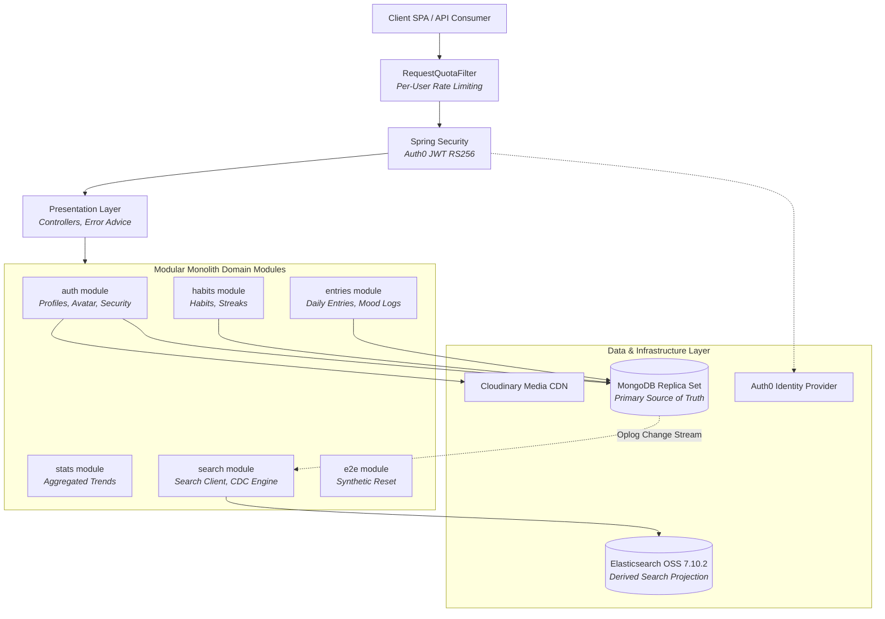
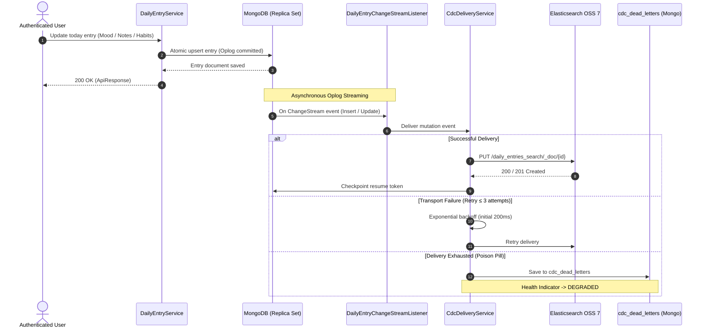
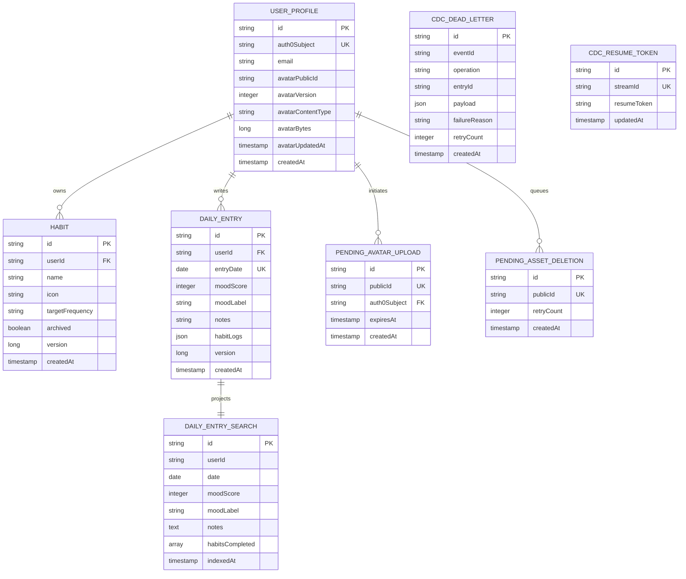

# Moodly - Habit & Mood Tracker Backend

Moodly is a production-grade, modular-monolith **Habit & Mood Tracking Platform** built with **Java 25** and **Spring Boot 4.1.0**. It is engineered as a **Headless Backend Architecture** — providing high-throughput REST APIs, asynchronous **Change Data Capture (CDC)** event streaming from **MongoDB Replica Set** to **Elasticsearch OSS 7.10.2**, **Auth0** OAuth2/JWT security, and **Cloudinary** media management.

> [!NOTE]
> - This repository contains the **Full Backend & Infrastructure Stack** (Spring Boot + MongoDB Replica Set + Elasticsearch).
> - The **Frontend Client** (React 19 + TypeScript + Vite + Tailwind CSS) is managed in a separate repository: [moodly-frontend](https://github.com/tlavu2004/moodly-frontend).
> - Planned roadmap: [Mood trend period navigation](docs/roadmap/mood-trend-periods.md).
> - Exception handling follows the [Moodly Exception Standard](docs/blueprint/exception-standardization-blueprint.md).
> - Architectural phases and MongoDB pipeline exercises: [Moodly Blueprint](docs/blueprint/moodly-blueprint.md).

---

## Table of Contents

- [Key Features](#key-features)
- [Architecture & Design](#architecture--design)
- [Change Data Capture (CDC) Pipeline](#change-data-capture-cdc-pipeline)
- [Database & Storage Schema](#database--storage-schema)
- [Tech Stack](#tech-stack)
- [API Overview](#api-overview)
- [Getting Started](#getting-started)
- [Environment Variables](#environment-variables)
- [Deployment (Render)](#deployment-render)
- [Deep-Dive Operations & Runbook](#deep-dive-operations--runbook)
  - [OpenAPI Contract Synchronization](#openapi-contract-synchronization)
  - [CI/CD & Container Publishing](#cicd--container-publishing)
  - [Auth0 Resilience & Startup Network Handling](#auth0-resilience--startup-network-handling)
  - [CDC Maintenance, Dead-Letter Queue & Reindexing](#cdc-maintenance-dead-letter-queue--reindexing)
  - [Mutation Replay & Concurrency Contracts (409 Conflict)](#mutation-replay--concurrency-contracts-409-conflict)
  - [E2E Playwright Synthetic User Reset Guard](#e2e-playwright-synthetic-user-reset-guard)
  - [Automated Integration Test Harness](#automated-integration-test-harness)
- [Authors](#authors)
- [License](#license)

---

## Key Features

### Habit Management & Streak Calculation
- **Habit Lifecycle**: Create, update, archive, and restore habits with daily target frequency (`DAILY`).
- **Real-Time Streak Tracking**: Dynamic calculation of current and best completion streaks calculated across the user's entry timeline.
- **Optimistic Concurrency Control**: All mutations enforce version checking (`@Version`) returning `409 Conflict` on concurrent stale writes.

### Daily Entries & Mood Journaling
- **Atomic Daily Journaling**: One canonical entry per day per user, capturing mood scores (1–5 scale), textual reflections, and habit check-ins.
- **Field-Level Atomic Upserts**: Simultaneous updates to disparate daily logs resolve safely without race conditions.
- **Last-Writer-Wins Semantics**: Conflicting edits to identical fields resolve predictably.

### Asynchronous Change Data Capture (CDC)
- **Oplog-Driven Streaming**: Taps directly into the MongoDB Replica Set Change Stream to stream daily entry mutations into Elasticsearch asynchronously.
- **Resilient Delivery**: Automatic retry with exponential backoff (3 attempts) on transport failures.
- **Dead-Letter Queue (DLQ)**: Poison pills or exhausted events are persisted in `cdc_dead_letters` and report `DEGRADED` health for zero data loss.
- **Operator Replay**: Internal administrative endpoints allow manual single-event replaying or full index rebuilds.

### Full-Text Elasticsearch Search
- **Fuzzy & Range Queries**: Fast multi-term search across user notes and entry history via Elasticsearch OSS 7.10.2.
- **Search Highlighting**: Server-side extraction and normalization of matched keyword fragments with highlight ranges.
- **Strict Data Isolation**: Search queries are strictly partitioned by authenticated subject (`userId`), preventing cross-tenant data leakage.

### HTTP Rate Limiting & User Quota Isolation
- **Per-Subject Quota**: Token-bucket algorithm with nanosecond precision isolating distinct authenticated users (default: 120 req/60s).
- **Graceful Throttling**: Throttled requests receive standard `429 Too Many Requests` responses with a dynamic `Retry-After` header.
- **Unified Error Envelope**: Structured error responses exposing `RATE_LIMIT_EXCEEDED`, timestamp, path, and tracing `X-Request-ID`.

### Auth0 Enterprise Security
- **Stateless OAuth2 Resource Server**: Validates signed RS256 JWT tokens against Auth0 JWKS endpoints.
- **Idempotent User Bootstrapping**: `PUT /auth/profile` bootstraps application-managed user profiles with no hidden side effects.
- **Custom Access Denied & Authentication Entry Points**: Traps 401/403 failures into standardized JSON envelopes without leaking stack traces.

### Cloudinary Media Lifecycle Management
- **Signed Upload Signatures**: Server-generated HMAC-SHA1 signatures ensuring zero client-side credential exposure.
- **Strict Media Constraints**: Enforces whitelist MIME checks (`jpg`, `jpeg`, `png`, `webp`) and file size limits (5 MiB).
- **Orphan Asset Cleanup**: Automated scheduled background jobs (`PendingAssetDeletionCleanup`) continuously delete stale/replaced avatars from Cloudinary.

### E2E Synthetic Reset Guard
- **Automated Test Guard**: Dedicated reset endpoint (`/internal/e2e/reset`) for automated Playwright browser tests.
- **Double Protection**: Hard-disabled in production via `@Profile("!prod & !production")` and guarded by a cryptographic constant-time token check.

---

## Architecture & Design

Moodly is designed as a **Modular Monolith** — structured by clear domain boundaries inside a single deployable unit.



### Module Boundaries
```
src/main/java/com/tlavu/moodly/
├── modules/
│   ├── auth/          # Profile synchronization, avatar signatures, cleanup jobs, Spring Security
│   ├── habits/        # Habit definitions, frequencies, optimistic versioning
│   ├── entries/       # Daily entries, mood ratings, habit logs, atomic upserts
│   ├── stats/         # Mood analytics, streak calculations, timeline aggregations
│   ├── search/        # Elasticsearch client, Change Stream listener, CDC worker, DLQ replay
│   └── e2e/           # Dedicated synthetic test account reset helper (non-prod only)
└── shared/            # Cross-cutting error envelope, RequestIdFilter, MDC logging, time utilities
```

---

## Change Data Capture (CDC) Pipeline

Moodly decouples primary transactional writes from full-text search indexing using an event-driven CDC pipeline:



---

## Database & Storage Schema

Moodly uses **MongoDB 7.x** (configured as a single-node replica set for Oplog access) as the authoritative source of truth, alongside **Elasticsearch OSS 7.10.2** for search projections.



---

## Tech Stack

| Category | Technology | Description |
| :--- | :--- | :--- |
| **Language** | Java 25 | Latest modern Java with virtual threads, pattern matching, and JDT null safety |
| **Framework** | Spring Boot 4.1.0 | WebMvc, Actuator, Security, Validation |
| **Primary Database** | MongoDB 7.x | Single-node Replica Set for document persistence and Change Streams |
| **Search Engine** | Elasticsearch OSS 7.10.2 | Derived read index for full-text search with highlighting |
| **Authentication** | Auth0 (OAuth2 / RS256 JWT) | Delegated identity with audience and issuer verification |
| **Media Storage** | Cloudinary | Cloud image CDN with server-signed upload presets |
| **API Documentation** | Springdoc OpenAPI 3.1.1 | Automated contract generation with zero-drift schema checks |
| **Build & Tooling** | Maven Wrapper 3.9.16 / Make | Strict reproducible builds, multi-stage caching |
| **Testing** | JUnit 5, AssertJ, Mockito, Test MockMvc | Unit, Security, and Docker-backed Integration Test Suites |
| **Code Quality** | JaCoCo 0.8.14 | Line & branch coverage enforcement (Instruction ≥ 80%, Branch ≥ 70%) |
| **CI / CD** | GitHub Actions | Automated PR testing, container building, and Dependabot auto-updates |
| **Containerization** | Docker & Docker Compose | Multi-stage JRE Alpine container with non-root security |
| **Hosting** | Render | Deployed as a managed container web service |

---

## API Overview

Base URL: `http://localhost:8080` (or your Render domain)

| Group | Base Path | Description | Access |
| :--- | :--- | :--- | :--- |
| **Auth & Profile** | `/auth/profile`, `/me/avatar` | Bootstrap profile, request avatar upload signature, confirm avatar | Authenticated |
| **Daily Entries** | `/entries` | Get range entries, get/update today's mood, notes, and habit completions | Authenticated |
| **Habit Tracking** | `/habits` | Create, list, update, archive, restore habits, calculate streaks | Authenticated |
| **Search** | `/entries/search` | Query daily entry reflections with fuzzy matching and highlights | Authenticated |
| **Dashboard** | `/dashboard` | Retrieve consolidated daily overview, active streaks, and current mood | Authenticated |
| **CDC Maintenance** | `/internal/cdc` | Rebuild search index, replay individual dead-letter events | Operator (`SCOPE_moodly:admin`) + Key |
| **E2E Reset** | `/internal/e2e/reset` | Reset synthetic browser test account (strictly disabled on prod) | Non-prod + Secret Token |
| **Observability** | `/actuator/health` | Service readiness, MongoDB status, Elasticsearch & CDC health | Public (components masked in prod) |

OpenAPI specification is committed at:
```
docs/api/json/moodly-openapi.json
```

---

## Getting Started

### Prerequisites
- **Java 25** (Eclipse Temurin recommended)
- **Maven Wrapper** (included; downloads the pinned Maven version on first use)
- **Python 3** only for container smoke and OpenAPI JSON normalization; local/test infrastructure and backend tests use Java
- **Docker Desktop** (with Compose v2)
- **GNU Make and Bash** for Make targets (install Make separately on Windows; Git Bash provides Bash)

---

Make targets and shell scripts use `./mvnw`. In PowerShell, use `.\mvnw.cmd`, for example `.\mvnw.cmd --version` or `.\mvnw.cmd test`. Make targets require a Bash-capable environment such as Git Bash or WSL. Use a Windows JDK in Git Bash and a Linux JDK with Docker integration in WSL. Bare `make` displays help.

### Step 1: Clone Repository and Configure Environment

```bash
git clone https://github.com/tlavu2004/moodly-backend.git
cd moodly-backend

# Create your local development environment file
cp .env.local.example .env.local
```

The local template supplies non-secret infrastructure defaults. Edit `.env.local` with your development credentials:
- **Auth0**: Create an API in your Auth0 dashboard, note its Identifier (`AUTH0_AUDIENCE`) and Domain (`AUTH0_ISSUER_URI`).
- **Cloudinary**: Create a signed upload preset (`moodly_local_signed`), set `CLOUDINARY_CLOUD_NAME`, `CLOUDINARY_API_KEY`, `CLOUDINARY_API_SECRET`, and `CLOUDINARY_UPLOAD_PRESET`.

---

### Step 2: Start Infrastructure & Run the Application

One shared infrastructure definition, `compose.local.yaml`, serves local and test. Commands select it explicitly with `-f`. The `moodly-local` project, local container names, and local volumes are preserved. Test data uses reserved namespaces on those same engines; see [Shared Development Infrastructure and Test Data Isolation](docs/architecture/shared-infrastructure-isolation.md).

#### Option A: Using Make (Recommended)

Run `make local-run` to start dependencies as needed and launch the backend at
`http://localhost:8080`. In another terminal, `make local-status` shows the shared
services. Ctrl+C stops the backend; when the last session ends, tooling stops only
the dependency containers it started automatically. Data volumes remain intact.

For a deliberately persistent stack, run `make local-up` first. This pins the
infrastructure so backend/test exit leaves it running. Finish all sessions before
`make local-stop` or `make local-down`; these commands reject active consumers.

#### Option B: Direct Shell Execution

```bash
bash scripts/docker/run-local-backend.sh
```

This uses the same Java session ownership and env loading as Make. No separate
infrastructure command is needed unless you want to pin it deliberately.

---

### Step 3: Run Tests

Moodly includes comprehensive Unit, Integration, and Security test suites:

```bash
# Run unit, security, and infrastructure integration tests
./mvnw test

# Run quality gates, packaging, and JaCoCo coverage checks
make verify

# Run CDC and Elasticsearch integration test suite (requires local Docker)
make cdc-test
```

---

## Environment Variables

### Core & Profiles

| Variable | Description | Required | Default |
| :--- | :--- | :---: | :---: |
| `SPRING_PROFILES_ACTIVE` | Active profile (`local`, `test`, `prod`) | No | `local` |
| `PORT` | Web server port | No | `8080` |
| `APP_CORS_ALLOWED_ORIGINS` | Comma-separated allowed frontend origins | **Yes** (Prod) | `http://localhost:5173,http://localhost:3000` |

### Database & Elasticsearch

| Variable | Description | Required | Default |
| :--- | :--- | :---: | :---: |
| `MONGODB_URI` | MongoDB connection URI (Replica Set required) | **Yes** (Prod) | `mongodb://localhost:27017/moodly_local?replicaSet=rs0` |
| `ELASTICSEARCH_URIS` | Elasticsearch cluster HTTP(S) endpoint | **Yes** (Prod) | `http://localhost:9200` |
| `ELASTICSEARCH_USERNAME` | Elasticsearch basic auth username | No | — |
| `ELASTICSEARCH_PASSWORD` | Elasticsearch basic auth password | No | — |
| `MOODLY_SEARCH_INDEX_NAME` | Name of the search projection index | No | `daily_entries_search` |
| `MOODLY_SEARCH_INDEX_INITIALIZATION_ENABLED` | Auto-verify and create index mapping on boot | No | `true` |

### Auth0 Security

| Variable | Description | Required | Default |
| :--- | :--- | :---: | :---: |
| `AUTH0_ISSUER_URI` | Auth0 tenant URL (must include trailing slash) | **Yes** | — |
| `AUTH0_AUDIENCE` | Unique API Identifier configured in Auth0 | **Yes** | — |
| `MOODLY_CDC_ADMIN_AUTHORITY` | Granted authority required for maintenance APIs | No | `SCOPE_moodly:admin` |

### Cloudinary CDN

| Variable | Description | Required | Default |
| :--- | :--- | :---: | :---: |
| `CLOUDINARY_CLOUD_NAME` | Cloudinary account cloud name | **Yes** | — |
| `CLOUDINARY_API_KEY` | Cloudinary API Key | **Yes** | — |
| `CLOUDINARY_API_SECRET` | Cloudinary API Secret (keep strictly confidential) | **Yes** | — |
| `CLOUDINARY_UPLOAD_PRESET`| Signed upload preset configured in Cloudinary | **Yes** | — |
| `CLOUDINARY_FOLDER` | Target folder prefix for media storage | No | `moodly/local` |

### Rate Limiting (Token Bucket)

| Variable | Description | Required | Default |
| :--- | :--- | :---: | :---: |
| `MOODLY_RATE_LIMIT_ENABLED` | Toggle HTTP rate limiting | No | `false` |
| `MOODLY_RATE_LIMIT_REQUESTS`| Max request allowance per window | No | `120` |
| `MOODLY_RATE_LIMIT_WINDOW` | Rate limit window duration | No | `60s` |

---

## Deployment (Render)

Moodly is fully production-configured for deployment on [Render](https://render.com) using its multi-stage `Dockerfile`.

Both Dockerfile stages use a readable tag plus an immutable multi-platform image digest. Dependabot checks Docker dependencies weekly; review tag/digest updates together and require image build and smoke checks before merging. A digest pin does not receive base-image security fixes until its update PR is merged.

### Multi-Stage Container Design
1. **Builder Stage (`maven:3.9.16-eclipse-temurin-25-alpine`)**: Leverages Docker BuildKit cache mounts (`--mount=type=cache,target=/root/.m2`) to download dependencies and compile without caching build artifacts in the final layer.
2. **Runtime Stage (`eclipse-temurin:25-jre-alpine`)**: Minimal Alpine JRE footprint running under a dedicated non-root user (`USER moodly`).
3. **Container Resource Optimization**:
   ```dockerfile
   ENTRYPOINT ["java", "-XX:MaxRAMPercentage=75.0", "-jar", "app.jar"]
   ```
   *Dynamically scales heap limits to 75% of available container memory, perfectly tuned for Render instances (512MB / 1GB RAM).*
4. **Built-in Healthcheck**:
   ```dockerfile
   HEALTHCHECK --interval=30s --timeout=5s --start-period=30s --retries=3 \
       CMD wget --quiet --spider http://localhost:8080/actuator/health || exit 1
   ```

### Deploying on Render:
1. Create a new **Web Service** on Render connected to this repository.
2. Select **Docker** environment.
3. Configure the **Health Check Path** to `/actuator/health`.
4. In **Environment Variables**, define `SPRING_PROFILES_ACTIVE=prod` alongside your production MongoDB Atlas URI, Elasticsearch URL, Auth0 domain/audience, and Cloudinary secrets.

---

## Deep-Dive Operations & Runbook

### OpenAPI Contract Synchronization

When changing controllers, request/response DTOs, OpenAPI annotations, or response type names, regenerate `docs/api/json/moodly-openapi.json`, review its diff, and commit it with the code change. Schema names can change even when endpoint paths do not. CI regenerates this file and fails if it differs from the committed version.

From the repository root, run `bash src/main/resources/scripts/openapi/generate-openapi.sh` on Linux.

In Windows Git Bash, use the following command if the checked-out script has CRLF line endings:

```bash
sed 's/\r$//' src/main/resources/scripts/openapi/generate-openapi.sh | bash
git diff -- docs/api/json/moodly-openapi.json
```

### CI/CD & Container Publishing

The repository currently retains Render source-build configuration in `render.yaml`. Publishing to GHCR does not deploy Render. The proposed image-by-digest migration and rollback procedure is documented in [the release runbook](docs/deployment/release.md); it requires a deliberate Render service migration.

Run `python3 scripts/docker/smoke-test.py IMAGE` after building/loading an image. The smoke test creates a unique test network and fresh MongoDB (tmpfs), Elasticsearch, and local OIDC fixture containers; it never loads env files or uses the manual local/test stacks. It checks the production profile, Docker healthcheck, public health privacy, unauthenticated API rejection, reset/docs unavailability, CDC-created search mapping, and non-root runtime. It removes only its own containers/network. This validates issuer discovery without hosted Auth0, but does not replace real-token E2E, Cloudinary uploads, or rate-limit behavior tests.

Pull requests targeting `main` run application and OpenAPI verification, followed by a container build. Run `PR CI` manually to check a feature branch before opening a pull request. Feature-branch pushes rely on the pull request run once a PR is open, avoiding duplicate verification.

Pushes to `main` and tags matching `v*` run `Release`. Verification must succeed before the image is built. Container smoke checks must pass before that same loaded image is pushed to GHCR. Full commit SHA tags and a `release-image.json` artifact record the published digest. Both workflows call the shared verification workflow. Verification has a 15-minute timeout, and image build/smoke/publish jobs have a 30-minute timeout.

A new PR run cancels an older run for the same PR. Release runs for the same ref are serialized, with cancellation of a running release disabled. Token permissions are read-only except for the publishing job, which requires `packages: write`.

External actions are pinned to full commit SHAs, with their major versions recorded in comments. Verify the upstream release commit when updating a pin. The main branch ruleset requires the PR verification and PR container build checks before merging.

### Auth0 Resilience & Startup Network Handling

JWT discovery and JWKS downloads require HTTPS access to your Auth0 tenant even when the local Docker services are healthy. The backend uses 10-second connect and read timeouts, with at most three attempts and a 500 ms delay for connection refusals/timeouts. Persistent failures still stop startup; issuer, audience, signature and expiry validation remain mandatory. HTTP errors and TLS certificate errors are not retried.

Optional Spring properties:
- `moodly.auth0.http.connect-timeout`
- `moodly.auth0.http.read-timeout`
- `moodly.auth0.http.max-attempts` (1–5)
- `moodly.auth0.http.retry-delay`

Their environment equivalents are:
- `MOODLY_AUTH0_HTTP_CONNECT_TIMEOUT`
- `MOODLY_AUTH0_HTTP_READ_TIMEOUT`
- `MOODLY_AUTH0_HTTP_MAX_ATTEMPTS`
- `MOODLY_AUTH0_HTTP_RETRY_DELAY`

No new secret is required. If all attempts fail, check network/proxy/firewall access to Auth0 rather than repeatedly restarting Docker or disabling JWT security.

Before first use, copy `.env.local.example` to `.env.local` if the environment files are not already present. `.env.local` is ignored by Git; it is also where Auth0 and Cloudinary development credentials belong.

#### Auth0 and Cloudinary Local Services Configuration
Before starting the backend, configure the hosted development services and fill the corresponding values in `.env.local`:
- In Auth0, create a Moodly API with a stable identifier and use it as `AUTH0_AUDIENCE`. Set `AUTH0_ISSUER_URI` to the tenant issuer URL, including `https://` and its trailing slash. Create a local SPA client, then add the local frontend URL (for example, `http://localhost:3000`) to its allowed callback, logout, and web-origin URLs.
- In Cloudinary, create the signed `moodly_local_signed` upload preset, accept only `jpg`, `jpeg`, `png`, and `webp`, store its Media Library assets in `moodly/local`, and disable overwrite. Set its values as `CLOUDINARY_CLOUD_NAME`, `CLOUDINARY_API_KEY`, `CLOUDINARY_API_SECRET`, and `CLOUDINARY_UPLOAD_PRESET`. Never copy `CLOUDINARY_API_SECRET` into frontend configuration.
- Set `CLOUDINARY_FOLDER` to `moodly/local`. The backend will append the resource type and owner, for example `users/{userId}/avatar/{uuid}`. Set `APP_CORS_ALLOWED_ORIGINS` to the exact comma-separated local frontend origins allowed to call the API. Do not add production URLs here yet.

### CDC Maintenance, Dead-Letter Queue & Reindexing

1. **Start MongoDB Replica Set and Elasticsearch**:
   ```bash
   make local-up
   ```
   The shared Compose stack contains only MongoDB and Elasticsearch. `make local-up` initializes the single-node replica set inside the running MongoDB container, then waits for MongoDB to become PRIMARY and Elasticsearch to be healthy. The operation is safe to repeat; `local-start` uses the same flow. No stopped initialization container is left in Docker Desktop. Run these Make targets from a Bash-capable environment (Git Bash on Windows) at the repository root. Alternatively run `bash scripts/docker/start-infrastructure.sh local` for either application environment. Once initialized, the replica-set configuration persists in the MongoDB volume and Docker Desktop Stop/Start works normally. MongoDB's health check reports healthy only when it is writable PRIMARY.

2. **Verify Cluster & Elasticsearch Mapping**:
   ```bash
   make local-status
   make local-replica-status
   make local-elasticsearch-status
   curl http://localhost:9200/_cat/indices/daily_entries_search?v
   curl http://localhost:9200/daily_entries_search/_mapping?pretty
   ```
   Elasticsearch is available at `http://localhost:9200`. Its data is kept in the `moodly-elasticsearch-local-data-oss7` Docker volume.

3. **Reindex Triggers & Change Stream Operations**:
   The Change Stream listener rebuilds the derived index from MongoDB when the checkpoint or index is missing. With both present, it resumes from the checkpoint stored in MongoDB.
   To rebuild the derived index deliberately, set `MOODLY_CDC_MAINTENANCE_KEY` in `.env.local`, then call:
   ```bash
   curl -X POST http://localhost:8080/internal/cdc/reindex \
       -H "X-Maintenance-Key: your-local-secret"
   ```
   Outside production, the maintenance header is the guard. Production also requires the operator JWT with `MOODLY_CDC_ADMIN_AUTHORITY` (default `SCOPE_moodly:admin`).

4. **Dead-Letter Handling & Exponential Backoff**:
   Failed Elasticsearch deliveries are retried three times with exponential backoff. Exhausted events are retained in MongoDB's `cdc_dead_letters` collection and can be replayed with:
   ```bash
   curl -X POST http://localhost:8080/internal/cdc/dead-letters/{id}/replay \
       -H "X-Maintenance-Key: your-local-secret"
   ```
   CDC health reports `DEGRADED` while dead letters remain; alert on this status and replay or rebuild the projection. A stopped listener or unavailable dead-letter count reports `DOWN`. In production, health details are hidden from public callers.

5. **Search Query Eventual Consistency**:
   `GET /entries/search?q=...` queries the derived Elasticsearch index. It is eventually consistent: a newly saved MongoDB entry can take a short time to appear in search results.

6. **Pending Avatar Cleanup**:
   Pending avatar deletions are retried when the asset is no longer referenced. A task for an avatar that remains active is checked again every five minutes and discarded after 24 hours without deleting the asset; a later replacement creates a new task.

7. **Elasticsearch OSS 7.10.2 & Managed Deployment (Searchly / Self-Hosted)**:
   The shared Compose stack uses the official Elasticsearch OSS 7.10.2 image. The backend uses JSON REST endpoints for index management, document CRUD, search, refresh, and the development E2E reset. The dedicated `-oss7` volumes allow Elasticsearch to build fresh indexes from MongoDB. Keep older Elasticsearch volumes available for rollback and mount only with their original engine version.
   For a managed endpoint, set `ELASTICSEARCH_URIS` to one HTTPS URL without user information. Set `ELASTICSEARCH_USERNAME` and `ELASTICSEARCH_PASSWORD` separately in the hosting environment for Basic authentication. Shared Compose binds MongoDB and unauthenticated Elasticsearch ports to loopback. MongoDB remains authoritative.
   When deployed on Render or cloud instances, if the application stops, CDC pauses. On restart, it resumes from MongoDB's checkpoint if the index exists and the token is still valid. A missing index or expired change-stream history triggers a rebuild from MongoDB. For index loss during uptime, monitor search errors and CDC dead letters, rebuild via the maintenance endpoint, and replay pending failures.

### Mutation Replay & Concurrency Contracts (409 Conflict)

- `POST /habits` creates a new UUID for every accepted request and does not accept an idempotency key. A client must not automatically replay it after a timeout or lost response; it should read the habit list before a user chooses to submit it again.
- `PATCH /habits/{habitId}` and the archive/restore POSTs require the latest habit `version`. A stale version returns HTTP `409 Conflict`; read the current habit before deciding on another change.
- `PUT /entries/today/mood` and `PATCH /entries/today` set the requested state. Repeating the same body leaves the same visible mood or habit-log state, but updates metadata and can emit another CDC event. Concurrent updates to different fields or habit logs are applied atomically; simultaneous updates to the same field follow last-writer-wins semantics. Avatar replacement uses a conditional profile update and retries competing replacements. Avatar upload signature/confirmation still has no general replay guarantee; each signature allocates a new public ID and confirmation consumes its pending upload.
- **Habit Streak Query Cost**: `GET /habits/{habitId}/streak` reads the authenticated user's entries on or before today for each requested habit. The frontend currently calls it once per active habit, in parallel. This repeated history read is accepted for small habit lists; a future summary endpoint should calculate all streaks from one history read if staging latency or habit counts exceed the threshold.

### E2E Playwright Synthetic User Reset Guard

The E2E reset endpoint is disabled by default and is not registered with the `prod` or `production` profile. To enable it for local Playwright runs, set `MOODLY_E2E_RESET_ENABLED=true`, choose a long random `MOODLY_E2E_RESET_TOKEN`, and set `MOODLY_E2E_USER_ID` to the Auth0 `sub` of the dedicated synthetic E2E account in `.env.local`. The account subject is read only from server configuration; the request cannot select a user. Keep the reset token in `.env.local` and out of frontend source and Git.

Start the local backend, then call the endpoint twice to verify repeatability:

```powershell
$tokenLine = Get-Content .env.local | Where-Object { $_ -like 'MOODLY_E2E_RESET_TOKEN=*' } | Select-Object -First 1
$resetToken = $tokenLine.Substring('MOODLY_E2E_RESET_TOKEN='.Length).Trim().Trim('"').Trim("'")
$headers = @{ 'X-E2E-Reset-Token' = $resetToken }
1..2 | ForEach-Object {
  Invoke-RestMethod -Method Post -Uri http://localhost:8080/internal/e2e/reset -Headers $headers |
    ConvertTo-Json -Depth 5 -Compress
}
```

Both responses should report the same configured `userId`, `habits: 2`, `entries: 3`, and `searchIndexing: "verified"`. The operation replaces only that subject's Moodly habits and daily entries, then verifies all seeded entries in Elasticsearch before returning success. It does not delete the Auth0 account or its application profile. If the endpoint is disabled, it returns `404`; a missing or incorrect token returns `403`.

`make validate-local` validates Compose without printing resolved values. `make config-local` prints resolved configuration and may expose sensitive settings. `make local-down` preserves volumes. `make local-clean CONFIRM=yes` deletes the shared volumes and affects local as well as test data; it is never part of test cleanup.

### Environment File Contract

- `.env.local` supplies local runtime settings and shared infrastructure; its example is the fresh-checkout default. Local database names are preserved when they already contain development data.
- There is no separate test dotenv template. Manual test uses the same local env file, with the same `SERVER_PORT` (normally 8080) and fixed reserved database/index names. Automated test fixtures live in `src/test/resources/application-test.yaml`. Retired `.env.test` files are not loaded.
- `.env.docs.example` supplies deterministic, non-secret documentation fixtures and `SERVER_PORT=8081`; optional ignored `.env.docs` overrides them. These files use unquoted `KEY=VALUE` syntax compatible with Java properties. The generation script reads the same port as the docs profile; it does not require credentials or a running Docker daemon.
- `.env.production.example` documents production variables. A container receives them through `docker run --env-file .env.production` or hosting environment injection; real env files are never baked into images. No hosting configuration is changed by this workstation migration.

Use the provided runners to load local/manual dotenv files. A bare Maven/Java/IDE launch must receive equivalent environment variables explicitly; Spring does not automatically treat arbitrary dotenv files as process environment. Startup-critical profile selection and destructive-operation guards remain code-controlled. Framework booleans that disable real side effects in docs mode are safety invariants, not arbitrary runtime tuning.

Keep `application-test.yaml`, Java test-support code, and the lease mechanism while automated tests exist. Both `.env.test.example` and the retired private `.env.test` have been removed. Neither is needed by the launcher, JUnit, or CI. Ignore rules remain to protect any stale private files in other checkouts. The zero-byte `.moodly-test.lock` is recreated automatically and uses no ongoing CPU/RAM; leave it ignored and do not unlink it while a session might hold its OS lock. Deleting configuration files does not reclaim a running container's memory.

See [Java Development Tooling Migration](docs/testing/java-tooling-migration.md) for the kept/removed/converted file inventory and verification results.

The shell entry points are thin adapters to `scripts/docker/run-tooling.sh`. It uses Maven Wrapper to compile test-side tooling and resolve the existing Jackson classpath, then starts `DevelopmentLauncher` with the project's Java runtime. `SharedInfrastructure` provides Compose parsing, namespace validation, idempotent startup, and the OS lease for both launcher and JUnit. These classes remain outside the production artifact. This adds a short Maven bootstrap on developer commands instead of requiring Python for infrastructure orchestration.

### Shared Infrastructure and Automated Test Isolation

See [the reusable architecture and migration guide](docs/architecture/shared-infrastructure-isolation.md) for engine/framework alternatives, resource ownership, concurrency, safety limits, and operation details.

There is one workstation infrastructure project: `moodly-local`, using `compose.local.yaml`. Local keeps its configured database/index; tests exclusively own MongoDB database `moodly_test` and Elasticsearch index `daily_entries_search_test`. These test resources are disposable. The launcher and integration harness reject collisions with configured local resource names and never accept arbitrary reset targets. These are safeguards for cooperating development tools, not per-database access control on the unauthenticated local engines.

```bash
make local-up           # explicit keep-alive pin; not needed before tests
make unit-test          # unit/security tests without infrastructure groups
make integration-test   # all infrastructure groups; resets only reserved test data
make test               # complete Java test suite
make verify             # complete suite, packaging, coverage and formatting gates
make cdc-test           # CDC/search integration group
make test-search-run    # manual backend with CDC/search enabled, exclusive test lease
make local-stop         # operator action: affects every local/test infrastructure user
```

Maven and IDE JUnit runs share the same harness. Integration groups are `*IntegrationTest` and `MoodlyApplicationTests`; `unit-test` excludes these classes. New infrastructure tests must follow the convention or update both selectors. The shared-infrastructure guards are ordinary JUnit tests under `src/test/java/com/tlavu/moodly/support`. Automated tests never load hosted Auth0/Cloudinary credentials into the application; `application-test.yaml` contains deterministic non-secret fixtures and test-only beans supply external clients.

Infrastructure coordinates come from `.env.local`, falling back to `.env.local.example` on fresh checkouts and CI. `MOODLY_INFRA_ENV_FILE` selects a different infrastructure file explicitly; CI uses the committed non-secret local example. The resolver reads the Compose service configuration without printing expanded env values. Local/manual runners forward every valid dotenv key, including `SERVER_PORT`, `SPRING_*`, and custom application keys; credentials are not printed or executed as shell code. Test resource names are fixed by the shared Java ownership contract; local configuration is checked for collisions before startup/reset. Shared engine coordinates still come only from the local infrastructure file. Obsolete per-test infrastructure keys must not be reintroduced.

Before an automated integration group, the harness closes the previous context and resets only the reserved database/index. The new context recreates database indexes and, for CDC/search groups, the search mapping. After each group it stops the listener, closes/evicts the context, and resets the same reserved resources. At session completion it cleans test data, releases its infrastructure session, and releases the test lease. The last consumer stops only automatically owned services. Preexisting or explicitly pinned services remain running; containers/networks/volumes are never deleted by session cleanup. Context cache size stays limited to one to bound memory.

Manual `make test-run` / `test-build-run` use the `compose-test` profile (which includes `local`) and hosted development Auth0/Cloudinary settings from the selected local env file. There is no second env overlay: manual mode inherits CDC/search/rate-limit settings from the selected local file and explicit caller overrides. The launcher always enforces test database/index and shared engine coordinates; old test infrastructure settings cannot redirect it. Local and manual backends share `SERVER_PORT` (normally 8080), so the registry allows only one backend session at a time. Manual mode resets the reserved test database/index before startup and after exit, failure, or normal Ctrl+C; local data remains untouched. Its exclusive lease prevents a cooperating automated session from resetting data while the backend is running. Local backend data is separately namespaced and can remain in use.

`test-cdc-run` remains an alias for env-controlled `test-run`. `test-search-run` enables CDC and search initialization for its process without editing env files. This can create/rebuild the derived test search index and adds background resource usage. With CDC intentionally disabled, the existing health indicator still reports DOWN; this health contract is unchanged. Reset endpoints remain opt-in outside production, guarded by a token and fixed synthetic identity.

The lease file `.moodly-test.lock` is outside Maven `target/` so `clean` cannot unlink an active lock. OS locks are released when handles/processes close; do not delete the file to bypass a running session. Manual and automated sessions acquire the same Java `FileLock` implementation. Normal interruption terminates the launched backend process tree before releasing the manual lease. After forcibly killing only a launcher, verify no backend child process remains before starting automated tests. This is per checkout: do not run another checkout against the fixed test resources concurrently. Use separately allocated namespaces or a shared lease service if cross-checkout parallelism becomes necessary.

Infrastructure ownership is recorded under ignored `.moodly-infrastructure/` using a short cross-process registry lock, PID/start-time identities, and per-session tokens. JUnit can coexist with the local backend; the last consumer stops only automatically started services. `make local-up` pins the stack even during an active session. `local-stop`/`local-down` refuse active sessions. Normal Ctrl+C stops backend writers before test-data cleanup and session release. A force-killed process cannot run shutdown hooks; the next session prunes stale records and recovers ownership. Do not edit/unlink registry files while sessions are active. Direct Docker commands and other checkouts bypass this per-checkout coordination. The old test infrastructure management targets (`test-up`, `test-stop`, `test-down`, `test-clean`, `config-test`, and `validate-test`) and `compose.test.yaml` have been removed. Existing old test containers/volumes are not deleted by this migration. If any are still running, stop them explicitly when no longer needed; review volume deletion separately. `clean-mongodb.sh test` uses the same Java lease and exact test database, with interactive confirmation; `.env.test` is accepted as a legacy argument but its file is not read.

Normal Ctrl+C after successful cleanup no longer produces a Make recipe Error 130. GNU Make may itself still return SIGINT status 130 when the terminal interrupts it. Real startup/cleanup failures remain errors; see [Backend Ctrl+C Exit Handling](docs/testing/interrupt-exit-status.md).

### Verify Once From a Cold Stack

See [Session Ownership Verification](docs/testing/session-ownership-verification.md) for lifecycle scenarios and measured results.

Run at the repository root in Git Bash/WSL with Java 25 and Docker available:

```bash
make local-stop                 # finish/stop backend sessions first; volumes stay intact
./mvnw --batch-mode verify
make local-status
```

Expect BUILD SUCCESS, coverage/format gates passing, and dependency containers
stopped after the final test session. For a warm stack intentionally started with
`make local-up`, verify leaves it running instead. Verify does not generate OpenAPI;
run `make openapi` separately when validating documentation changes. Docs tooling
uses port 8081; automated MockMvc integration tests need no dedicated HTTP port.
Manual tests use `make test-run` or `make test-search-run` on port 8080 and discard
their database/index state on exit. Hosted Auth0 accounts and Cloudinary assets are
not removed by this local cleanup.


---

## Authors

| Student ID | Full Name | GitHub |
| :--- | :--- | :--- |
| **22120443** | Trương Lê Anh Vũ | [@tlavu2004](https://github.com/tlavu2004) |

---

## Contribution

1. Fork the repository.
2. Create a feature branch: `git checkout -b feature/amazing-feature`.
3. Commit your changes following Conventional Commits: `git commit -m 'feat: add amazing feature'`.
4. Push to the branch: `git push origin feature/amazing-feature`.
5. Open a Pull Request against `main`.

---

## License

This project is licensed under the [MIT License](LICENSE).
