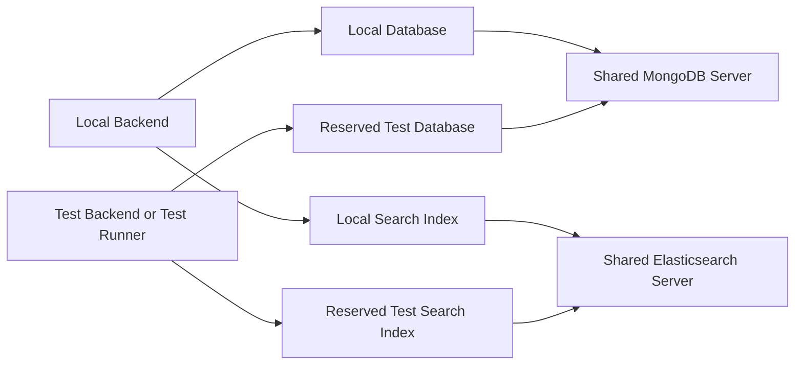

# Shared Development Infrastructure and Test Data Isolation

## Purpose and Scope

This guide describes a reusable architecture for sharing development infrastructure
between applications and test processes without sharing ownership of their data.
It applies to Spring Boot, NestJS, and other backends, and to relational databases,
document databases, search engines, caches, queues, and object stores.

The deployment environments remain **local**, **test**, and **production**. A
container, a database, a Spring profile, and a deployment environment are different
concepts. Sharing one database server does not merge local and test application
configuration. A short-lived CI runner is part of test, not another environment.

This is a design and operational guide, not a universal framework or a claim that
logical namespaces provide the same protection as separate machines or accounts.

## Architecture Decision

On a developer workstation, prefer one infrastructure stack when applications need
the same compatible engine versions and tests run sequentially. Allocate explicit
resources to each application and purpose. Preserve production on separate hosted
infrastructure and credentials. Use fresh infrastructure on CI runners.

For Moodly, use project `moodly-local` and `compose.local.yaml` for MongoDB and
Elasticsearch. Local keeps its existing configured database/index. Automated and
manual test sessions own database `moodly_test` and index
`daily_entries_search_test`. These names are reserved and disposable. Automated
cleanup deletes only those exact resources and never stops the shared services.
Manual test and automated test sessions acquire the same exclusive lease.

## Isolation Boundaries

| Boundary | What It Separates | What It Still Shares |
| --- | --- | --- |
| Different table names or row tenant IDs | Selected application records | Database ownership, transactions, migrations, accidental broad queries |
| Separate schema | SQL object namespaces | Database and engine, unless access grants also restrict them |
| Separate database or search index | Data and common cleanup targets | Server resources, availability, administrators, engine settings |
| Separate container and volume | Processes and storage mounts | Host kernel, Docker daemon, hardware |
| Separate host/account/network | Larger failure and access domains | Depends on the hosting boundary and permissions |

Choose the least expensive boundary that satisfies the actual concurrency,
permission, compatibility, and failure requirements. Namespace isolation prevents
routine collisions; credentials and grants constrain damage from a faulty process.
Neither naming nor a developer file lock is an adversarial security boundary.

Moodly's local MongoDB and Elasticsearch OSS currently have no per-namespace
credentials. Loopback bindings and exact-target cleanup are safeguards, not RBAC.
Do not share these unauthenticated services across untrusted users or machines.

## Naming and Resource Ownership

Use identifiers containing application, purpose, and resource type where needed.
For multiple apps, examples are `moodly_local`, `moodly_test`, `billing_local`, and
`billing_test`. Search indexes can be `moodly_entries_local` and
`moodly_entries_test`. Explicitly preserve established local names during migration
rather than renaming them and accidentally hiding existing data.

Maintain a resource manifest with application, environment, endpoint, namespace,
owner, cleanup policy, and migration version. Distinguish retained local data from
disposable test data. Never infer cleanup permission from a substring such as
`test` in a database name. Reject wildcards, aliases, lists, URLs with embedded
paths, empty names, and unexpected resource names before destructive operations.

A test runner should enumerate the exact resources it owns. It must not discover
all databases or indexes on a server and delete matching names. A local backend
must refuse to use reserved test namespaces; test configuration must override
inherited local connection settings before creating repositories or running jobs.

## Engine-Specific Patterns

### PostgreSQL

Prefer a separate database per application/purpose for straightforward ownership
and cleanup. Separate schemas can reduce database provisioning overhead, but require
explicit schema/search-path configuration for both runtime and migrations. A schema
name alone does not prevent cross-schema access. Avoid search paths that include
schemas writable by unrelated users. Use separate roles and narrow grants; keep
migration/admin capabilities separate from routine application access.

Migration examples: configure Flyway or Liquibase in Spring, or the selected ORM's
migration data source in NestJS, to the test database/schema. Validate the target
before running migrations, truncation, or schema recreation. Transaction rollback
is useful for repository tests but cannot undo messages, background jobs, another
connection's committed changes, or external service calls.

### MySQL and MariaDB

In MySQL, database and schema refer to the same namespace. Use separate databases
and database-scoped users/grants rather than expecting PostgreSQL-style nested
schemas. Review engine-specific DDL and transaction behavior; migration/DDL changes
must not be assumed reversible by a test transaction. Compatibility with MariaDB
must be evaluated for the actual server version and features in use.

### MongoDB

Use a separate database for each application/purpose. Collection indexes,
checkpoints, outbox records, dead letters, and scheduled-job records must belong to
that database. Database deletion is appropriate only for a reserved disposable
database. If authentication is enabled, grant only the necessary operations on that
database and explicitly review privileges needed for migrations and cleanup.

Change streams and transaction tests require the appropriate MongoDB deployment
capabilities. A standalone test server may not represent production behavior.
With a shared replica set, namespace every listener and checkpoint consistently;
never let a test listener consume another database's collections.

### Elasticsearch and Similar Search Engines

Use separate concrete indexes. Both query reads and projection writes must use the
same configured index. CDC/reindex jobs, templates, aliases, checkpoints, retries,
and dead letters also need consistent ownership. Reject `_all`, wildcards, aliases,
and comma-separated lists for cleanup; index naming alone does not authorize it.

A new test index needs its actual mappings and settings, not merely an empty index.
Wait for asynchronous projection convergence with bounded polling and diagnostics,
not fixed sleeps. When engine security is available, scope index privileges to the
owned resources. Moodly OSS 7.10.2 does not implement the modern Elastic security
features described in current Elastic documentation.

### Caches, Queues, Object Storage, and External Services

A database boundary is insufficient if tests still share Redis keys, queue names,
consumer groups, object keys, filesystem paths, or external accounts. Namespace each
resource. Do not use global cache flush or broker-wide purge commands. Redis logical
databases are not equivalent to independently secured servers; cluster support also
varies. Use separate queue/vhost resources where supported and narrowly scoped
object prefixes or buckets according to permissions.

Use local fixtures for automated Auth0/OIDC and Cloudinary-equivalent interactions.
Real hosted integrations belong in explicitly configured E2E tests with dedicated
identities/assets. Do not reuse production credentials or treat a database rollback
as cleanup for an external upload or email.

## Framework Integration

### Spring Boot

Keep infrastructure coordinates separate from application namespace selection.
Apply test URI/database/index properties before the application context creates
clients, indexes, listeners, or scheduled jobs. Use test-only JWT/client beans for
integration tests and retain real security behavior in dedicated security tests.
Use an application profile for configuration; do not use a profile name as the
sole authorization for a database drop. Close listeners and contexts before reset.
JUnit/IDE and Maven entry points must use the same ownership and cleanup policy.

### NestJS and Other Node.js Backends

Validate environment configuration before compiling the application/testing module.
Configure the ORM/Mongoose/SQL client and search adapter from a single validated
resource description. Do not import a default production/local connection before
test overrides are applied. In Jest or another runner, coordinate global setup,
worker count, namespace ownership, and teardown; close app instances, pools,
listeners, and timers before deleting owned resources.

Use separate data-source instances for concurrent test workers or give each worker
its own namespaces. In-process dependency-injection overrides do not isolate other
processes, scheduled jobs, or shared external services.

### Other Frameworks

The same contract applies to Django, Rails, Laravel, Go, and .NET: validate target,
acquire ownership, initialize schema/mapping, exercise behavior, stop writers,
clean only owned data, release ownership. Framework-specific convenience commands
must not bypass the target guard.

## Lifecycle and Concurrency

1. Resolve the shared infrastructure configuration without logging secrets.
2. Validate local and reserved test namespaces are distinct before any reset.
3. Acquire the exclusive test lease before starting a manual or automated session.
4. Start shared dependencies if necessary; initialize replica sets idempotently.
5. Validate readiness, then clean only the reserved test resources for automated tests.
6. Create migrations/indexes, start the application, and run the test group.
7. Stop background writers, close clients/contexts, and reset the owned resources.
8. Release the lease. Leave shared infrastructure running for local users.

A per-checkout file lease protects cooperating processes in that checkout. It does
not coordinate another checkout or another host. If those must share endpoints,
use a shared lease service or distinct per-worker databases/indexes. Namespace
allocation and cleanup tracking become necessary only when parallelism requires
them; do not introduce them for a single sequential workstation workflow.

Crashes can leave test records, which the next automated session may clear after
obtaining the lease. Never delete a lock file to bypass an active OS lock. Release
is tied to the file handle/process, not the mere existence of the lock filename.
Cleanup failures must fail the test command and preserve useful diagnostics.
Normal launcher interruption must stop its backend process tree before releasing
the lease. A force-killed launcher can orphan children; verify those processes are
stopped before reusing fixed test namespaces.

## Test Types and Behavior

| Type | Dependencies | State Policy | Typical Entry Point |
| --- | --- | --- | --- |
| Unit and security slices | Mocks/fixtures | In-memory or narrowly scoped fixtures | Unit runner |
| Infrastructure integration | Real shared engines | Reserved test namespaces, exclusive lease | Integration runner |
| Manual test backend | Shared engines and development hosted services | Disposable test namespaces | Manual runner |
| E2E | Browser/API and explicitly chosen integrations | Dedicated synthetic identity and owned resources | E2E runner |
| Container smoke | Fresh CI fixture infrastructure | Disposable runner/container state | Built image smoke command |

Disable unrelated rate limiting for deterministic bulk functional tests; test 429
behavior separately with limits enabled. Enable CDC/mapping initialization for
search scenarios. Reset endpoints must be opt-in outside production, fixed to a
dedicated identity, and protected independently of ordinary application JWTs.

## Resource Costs and When to Split Again

One running engine pair avoids duplicate baseline memory, caches, and background
threads. Namespaces still consume disk, indexes, cache, and operation time; shared
infrastructure does not make test data free. Stopped containers generally retain
storage but are not equivalent to a second running JVM in RAM usage. Measure actual
container memory/CPU and disk rather than treating configured heap as total RSS.

Split into separate containers or hosts when engine versions differ, test load
makes local work unusable, fault-injection/restarts are required, credentials cannot
be constrained appropriately, or jobs need independent server-level settings.
Use fresh services per CI job; sequential groups in a job may reuse those services.
Never run a fault-injection or server-reconfiguration test against shared local data.

## Migration and Verification Checklist

- Inventory names, ports, volumes, server versions, and existing retained data.
- Preserve the retained local volume identities and namespace defaults.
- Reserve exact test namespaces and reject local/test collisions before reset.
- Update runners, IDE hooks, migrations, cleanup scripts, documentation, and CI.
- Remove the second Compose definition only after all references are migrated.
- Leave old test volumes alone; removal is a separate explicit storage operation.
- Seed a uniquely identified sentinel in a local namespace, run full integration,
  verify the sentinel survives, then delete only the sentinel created for this check.
- Verify shared containers remain running after test completion.
- Verify lock contention, invalid targets, wildcard rejection, startup failures,
  and release of resources on interruption.
- Run the full application suite, coverage/format checks, and container smoke where
  relevant. Record what was executed and what remains outside validation scope.

## Moodly Operational Contract

Infrastructure lives in `compose.local.yaml`. `.env.local` supplies local
infrastructure coordinates, with `.env.local.example` as a fresh-checkout/CI fallback.
`MOODLY_INFRA_ENV_FILE` can select an explicit infrastructure file. Real env files
are not modified by migration. `.env.test` supplies optional manual-test application
settings, not authority to change infrastructure ports or cleanup targets. Existing
old test ports and unqualified index names are no longer used by the harness.

Reserved test names are `moodly_test` and `daily_entries_search_test`. Local
configuration must not select either. Local/backend exit and integration cleanup
leave `moodly-local` running. Explicit `make local-stop`/`local-down` affect every
consumer, so stop them only when all sessions are finished. Volume deletion remains
an explicitly confirmed operator action and is never part of automated tests.

The test lease is per checkout; run one checkout against these fixed test names at
a time. Other applications sharing these engine instances must reserve different
names and apply equivalent ownership rules. Production and hosted settings are
outside this workstation migration.

## References

- [PostgreSQL Schema and Search Path Boundaries](https://www.postgresql.org/docs/17/ddl-schemas.html)
- [MySQL CREATE DATABASE](https://dev.mysql.com/doc/refman/8.4/en/create-database.html)
- [MongoDB Database Roles](https://www.mongodb.com/docs/manual/reference/built-in-roles/)
- [Elasticsearch Index Privileges](https://www.elastic.co/guide/en/elasticsearch/reference/current/security-privileges.html/)
- [Docker Compose Application Model](https://docs.docker.com/compose/intro/compose-application-model/)

These references describe engine behavior, not proof of permissions configured in
this repository. Adapt version-specific details to the engines actually deployed.
